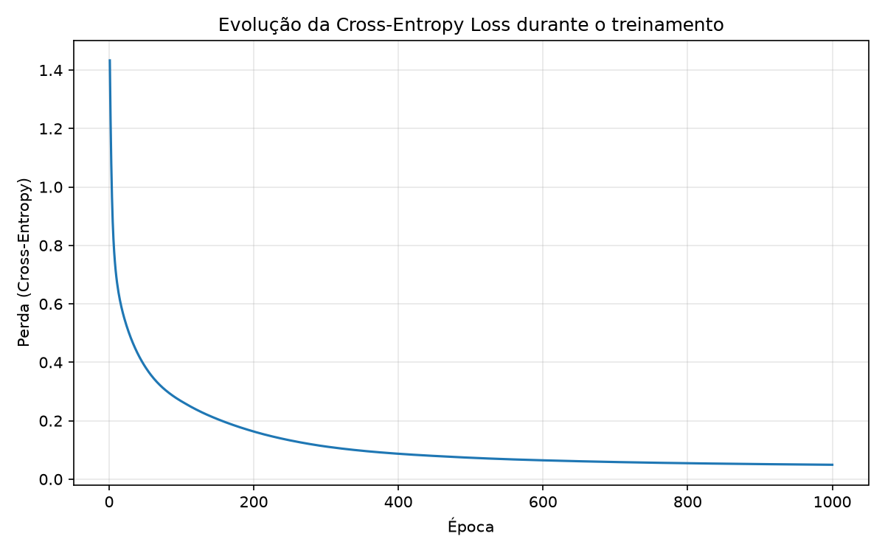

# Rede Neural Artificial do zero: classificação do Iris

Atividade da disciplina de Inteligência Artificial, Ciência da Computação, UNIPAC Barbacena.

Rede neural com uma camada escondida (arquitetura **4-8-3**) implementada **do zero com NumPy** para classificar as três espécies de flores do conjunto de dados Iris. Forward Pass, função de perda, Backpropagation e Gradiente Descendente foram escritos manualmente. O Scikit-Learn é usado **somente** para carregar e dividir os dados.

## Resultado

| Métrica | Valor |
|---|---|
| Perda inicial (Cross-Entropy) | 1,4331 |
| Perda final (após 1000 épocas) | 0,0494 |
| Acurácia no treino (120 amostras) | 97,50% |
| **Acurácia no teste (30 amostras)** | **96,67%** (29 de 30) |

Matriz de confusão no conjunto de teste (linha = classe real, coluna = classe prevista):

| | setosa | versicolor | virginica |
|---|:-:|:-:|:-:|
| **setosa** | 10 | 0 | 0 |
| **versicolor** | 0 | 9 | 1 |
| **virginica** | 0 | 0 | 10 |

O único erro foi uma *versicolor* classificada como *virginica*, duas espécies com medidas parecidas. Como o teste tem apenas 30 amostras, cada flor vale cerca de 3,3 pontos percentuais.

### Evolução da perda



## Arquitetura 4-8-3

```
Entrada (4)  ->  Escondida (8, ReLU)  ->  Saída (3, Softmax)
sépala comp.     8 neurônios              probabilidade de cada espécie
sépala larg.                              (setosa, versicolor, virginica)
pétala comp.
pétala larg.
```

| Parâmetro | Shape | Quantidade |
|---|---|---|
| `W1` | (4, 8) | 32 |
| `b1` | (1, 8) | 8 |
| `W2` | (8, 3) | 24 |
| `b2` | (1, 3) | 3 |
| **Total** | | **67** |

Pesos iniciais sorteados de uma normal com escala `sqrt(2 / n_entradas)` (inicialização He), vieses aleatórios pequenos e semente fixa (`SEED = 42`) para reprodutibilidade.

## Como funciona

**Pré-processamento.** Divisão estratificada 80/20 em treino e teste **antes** da padronização. A média e o desvio padrão são calculados **só com o treino** e aplicados ao teste, para evitar vazamento de dados. Os rótulos são convertidos para One-Hot (vetores binários de tamanho 3).

**Forward Pass.**

```
Z1 = X·W1 + b1      A1 = ReLU(Z1) = max(0, Z1)
Z2 = A1·W2 + b2     A2 = Softmax(Z2)
```

A Softmax transforma os valores de saída em probabilidades entre 0 e 1 que somam 1:
`softmax(z_i) = e^(z_i) / soma_j e^(z_j)`

**Função de perda (Cross-Entropy).**
`L = -(1/n) * soma( Y * ln(A2) )`
Só conta a probabilidade atribuída à classe correta: quanto menor ela for, maior a perda.

**Backpropagation (regra da cadeia, da saída para a entrada).**

```
dZ2 = (A2 - Y) / n            (Softmax + Cross-Entropy se simplificam)
dW2 = A1ᵀ · dZ2               db2 = soma das linhas de dZ2
dA1 = dZ2 · W2ᵀ
dZ1 = dA1 * (Z1 > 0)          (derivada da ReLU)
dW1 = Xᵀ · dZ1                db1 = soma das linhas de dZ1
```

O Backpropagation foi validado com *gradient check*: o gradiente calculado bate com a estimativa por diferenças finitas, com diferenças da ordem de 1e-11.

**Gradiente Descendente.** `parâmetro = parâmetro - η * gradiente`, com taxa de aprendizado `η = 0,1`.

**Treinamento.** 1000 épocas com o conjunto de treino completo. Cada época executa forward, perda, backward e atualização dos 67 parâmetros.

**Avaliação.** A inferência é um Forward Pass com os pesos já treinados, e a classe prevista é a de maior probabilidade (`argmax`). A acurácia é o número de acertos dividido pelo total de amostras do teste, que não participou do treinamento.

## Estrutura do projeto

```
projeto_rna_iris/
├── rna_iris.py        # código completo, organizado em seções
├── requirements.txt   # dependências
├── perda.png          # gráfico da evolução da perda
└── README.md
```

Seções do `rna_iris.py`:

1. Imports e semente
2. Carregamento e pré-processamento dos dados
3. Inicialização dos parâmetros
4. ReLU, Softmax, Forward Pass e Cross-Entropy
5. Backpropagation e atualização por Gradiente Descendente
6. Loop de treinamento e gráfico da perda
7. Inferência, acurácia e matriz de confusão

## Como executar

```
pip install -r requirements.txt
python rna_iris.py
```

O script treina a rede, imprime a perda a cada 100 épocas, mostra a comparação entre classes reais e previstas no teste, a matriz de confusão e a acurácia, e salva o gráfico em `perda.png`. A execução é reprodutível: com a mesma semente, o resultado é sempre o mesmo.

## Conformidade com o enunciado

- Python e NumPy para todos os cálculos da rede.
- Scikit-Learn apenas para `load_iris` e `train_test_split`.
- Sem TensorFlow, Keras, PyTorch ou modelos prontos de Machine Learning.
- Forward Pass, Cross-Entropy, Backpropagation e Gradiente Descendente implementados manualmente.
- Matplotlib usado somente para desenhar o gráfico da perda.
